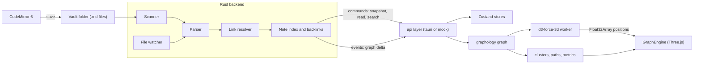

# Amethyst: graph-first, Obsidian-compatible notes for macOS

## Decisions already made
- **Stack:** Tauri 2 (Rust backend) with React, TypeScript, and Vite. It builds with the Xcode Command Line Tools this Mac already has; full Xcode isn't needed.
- **Fully local:** no AI, no network calls, no telemetry. Fonts are bundled through `@fontsource`. The Tauri content security policy is locked to `self`.
- **Vaults:** it opens existing Obsidian vaults as-is. It reads `.md` files, `[[wikilinks]]` (including the `|alias`, `#heading`, and `![[embed]]` forms), `#nested/tags`, and frontmatter `tags`/`aliases`. Amethyst's own state goes in `<vault>/.amethyst/`, and it never writes to `.obsidian/`.
- **Look:** "Amethyst Nebula": a `#07060B` deep-space base, violet/magenta/cyan glow, frosted-glass panels, and thin HUD lines with monospace readouts.
- **Graph:** 3D by default, with a 2D mode one toggle away.

## Core UX concept: the graph is the desktop
- The 3D galaxy fills the whole window at all times. Notes open in frosted-glass panels that float above it, blurred with `backdrop-filter`.
- **Write mode:** the panels are in front and the graph dims and drifts slowly in the background, rendered at a throttled frame rate to save battery. Opening a note flies the camera to that note's node.
- **Graph mode** (`Cmd+G`): the panels slide away and the graph becomes fully interactive.
- If you'd rather have Obsidian-style tabs with the graph as just one tab, this concept is the thing to change.

## Architecture



- **Rust is the source of truth** for files, parsing, and link resolution. It sends the frontend a full snapshot once, then sends small deltas (`upsertNodes`, `removeNodes`, `upsertEdges`, `removeEdges`) as files change.
- **The frontend keeps a mirror of the graph in `graphology`.** Graph analysis (clusters, paths, hub scores) runs on that mirror.
- **The `api/` layer has two implementations:** `tauri.ts`, which talks to the real backend, and `mock.ts`, which serves a fixture vault. With the mock, the UI runs in a plain browser for fast iteration and visual testing. This matters because Tauri's WebDriver end-to-end testing doesn't support macOS.
- **All file access goes through Rust commands,** and every path is checked so it can't escape the vault root. The Tauri `fs` plugin isn't used.

### Graph engine approach
I recommend a custom engine: a self-contained `GraphEngine` class in plain Three.js (WebGL2) with a thin React wrapper.
- Nodes are drawn with `InstancedMesh`, as camera-facing quads with a radial-glow shader. Each node carries GPU attributes: color, size, `aBirth` (creation time), `aHop` (hops from the focused note), and `aHighlight`.
- Links are drawn as one batched line geometry whose shader animates a pulse flowing from source to target.
- Effects come from pmndrs `postprocessing` (bloom, vignette, subtle chromatic aberration), plus a nebula/starfield sky shader and depth fog.
- Labels use `troika-three-text` and appear only for hovered and focused nodes and the top hubs near the camera.
- Camera movement uses `camera-controls`. 2D mode re-runs the layout with `numDimensions: 2` and moves to a top-down camera.

Because every effect is a shader driven by a uniform or a per-node attribute, time-lapse, focus ripple, path beams, and live pulses are all cheap to add.

The alternative is the `3d-force-graph` library. It would get something on screen within a day, but it creates one mesh per node and would fight these custom effects. It stalls at around 5,000 nodes.

### Engine API (the seam the React UI uses)
```ts
engine.setGraph(snapshot); engine.applyDelta(delta);
engine.setMode('3d' | '2d'); engine.setColorMode('cluster' | 'folder' | 'tag' | 'age');
engine.focus(nodeId, { hops }); engine.showPath(nodeIds); engine.clearOverlays();
engine.setTimelapse({ t, playing }); engine.setAmbient(isBackground);
engine.on('hover' | 'select', cb);
```

## Project layout
- [src-tauri/src/vault/](src-tauri/src/vault/) contains:
  - `scanner.rs`: walks the vault and skips `.obsidian`, `.amethyst`, `.git`, and `.trash`.
  - `parser.rs`: extracts links, tags, frontmatter, and headings using `pulldown-cmark` events, so text inside code blocks and inline code is ignored.
  - `resolver.rs`: implements Obsidian's link rules, in order: exact path, then a unique basename (case-insensitive), then aliases, then the shortest path.
  - `index.rs`: holds the notes, backlinks, and unresolved targets, and produces snapshots and deltas.
  - `watcher.rs`: watches files with `notify` and `notify-debouncer-full`.
- [src-tauri/src/commands.rs](src-tauri/src/commands.rs) holds the `#[tauri::command]` functions: `open_vault`, `read_note`, `write_note`, `create`/`rename`/`delete`, `graph_snapshot`, and `search`.
- [src/api/](src/api/), [src/state/](src/state/), [src/editor/](src/editor/), and [src/ui/](src/ui/) hold the frontend: the shell, sidebar, glass panels, palette, radar, and theme tokens.
- [src/graph/engine/](src/graph/engine/) holds `nodes.ts`, `edges.ts`, `effects.ts`, `labels.ts`, `camera.ts`, and `shaders/`. Alongside it, [src/graph/layout.worker.ts](src/graph/layout.worker.ts) runs the layout and [src/graph/analysis.ts](src/graph/analysis.ts) runs the analysis.
- [fixtures/sample-vault/](fixtures/sample-vault/) holds a sample vault, and [scripts/gen-vault.ts](scripts/gen-vault.ts) generates a synthetic vault (for example 10,000 notes linked the way real notes tend to be: a few heavily linked hubs and many sparsely linked notes) for performance testing.

## Phases (each ends in a usable app)

**Phase 1: Foundation (a plain, working notes app)**
- Scaffold Tauri. The window uses `titleBarStyle: Overlay` with a hidden title, so it's frameless with traffic lights. Add a native menu with keyboard shortcuts, a recent-vaults list, and the theme tokens and bundled fonts.
- In Rust, build scanning, parsing, link resolution, the index, and the watcher, written test-first with `cargo test` against the fixture vault.
- Add a file explorer and a CodeMirror 6 markdown editor with sized headings, dimmed syntax, clickable wikilinks, `[[` autocomplete, and debounced autosave. Add a backlinks and outgoing-links panel.

**Phase 2: Graph engine**
- Build `GraphEngine` with node glow, flowing links, bloom, the nebula sky, fog, and labels. Run the layout in a worker and cache node positions per vault in `.amethyst/layout.json`, so reopening a vault is instant. Add the 3D/2D toggle, hover and select, and opening a note from the graph.
- Build the graph-as-desktop shell (write mode and graph mode). Respect macOS "Reduce motion" via `prefers-reduced-motion`.
- Performance targets on Apple Silicon: 60 fps at 5,000 nodes and 15,000 links, and still usable at 20,000 nodes.

**Phase 3: Signature graph features**
- **Focus dive:** the camera flies to the note, a ripple lights up its neighbors one hop at a time (depth of 1 to 3 hops), the rest of the graph dims, and `Esc` exits.
- **Live graph:** a new note spawns next to the note it links to with a burst of light, an edited note pulses, and a new link draws in as a beam. The layout is nudged gently instead of being re-run from scratch.
- **Constellations:** Louvain clustering (`graphology-communities-louvain`) with an extra layout force that pulls each cluster together, and a label for each cluster named after its biggest hub note. Color modes: cluster, folder, tag, or age.
- **Path finder:** pick two notes and see the shortest chain of links between them (`graphology-shortest-path`), with a beam traveling the route, the camera framing it, and a clickable list of every step.
- **Time-lapse:** a scrubber with play/pause and speed control replays the vault's growth. Each note's date comes from its frontmatter `created`/`date` if present, otherwise the file's creation time, otherwise its last-modified time.
- **Vault Radar** (a heads-up display panel): counts, orphan notes, broken links, top hubs ranked by PageRank, and the largest clusters. Clicking any item triggers a focus dive.

**Phase 4: Power features and polish**
- A command palette (`Cmd+K`), a quick switcher (`Cmd+O`), full-text search in Rust over cached note text, a tags pane, and renaming that updates every link pointing at the note.
- Obsidian-style live preview, which hides markdown syntax on lines you aren't editing, plus a reading view with images loaded through Tauri's asset protocol.
- Unlinked mentions, and keyword-based (TF-IDF) similar notes, which can optionally appear in the graph as faint dotted "ghost links".
- Optional UI sounds synthesized with Web Audio, off by default. Packaging as a `.app`/`.dmg` with ad-hoc code signing.

## Testing
- **Rust:** unit tests for the parser and link resolver, covering edge cases such as aliases, headings, embeds, links inside code blocks, and duplicate note names. Index and delta tests run against the fixture vault.
- **Frontend:** Vitest tests for applying deltas, the analysis functions (clusters, paths, metrics), and the store logic.
- **Visual and performance:** run the UI in the browser with the mock backend, and check frame rate using vaults made by `gen-vault.ts`.